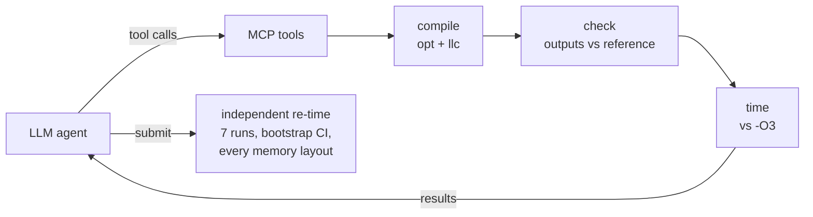

# o4-llvm

**Found real 1.24× and 1.17× speedups over LLVM's `-O3` on PolyBench, on an Apple M2.** The LLM agent found the floyd-warshall win in 1 of every 2 to 3 seeds; random search with the same 30-compile budget never found it.

The name is the joke: `-O4`, one level past `-O3`.

## How it works

An LLM agent gets a budget of 30 compiles per benchmark. It works through MCP tools: compile a pipeline, check the output is correct, time it against `-O3`, read optimization remarks. At the end it submits one build. An independent protocol then re-times that build, and only that measurement is reported. The agent is compared against random search with the same budget, on 22 PolyBench kernels.



## Results

| Benchmark | Speedup over `-O3` | Found by | Why it's faster |
|---|---|---|---|
| jacobi-2d | **1.24×** | random search and both agents, every seed | Address arithmetic changes so loads pair into `ldp` instructions: 29% fewer load/store instructions ([D10](docs/decisions.md#d10-validating-the-phase-1-wins-one-optimization-one-microarchitectural-accident-2026-10-31), [D12](docs/decisions.md#d12-hardware-counters-through-a-privilege-dropping-launcher-2026-10-31)) |
| floyd-warshall | **1.17×** | both agents (1 in 2–3 seeds), never random search | O3's vectorized loop never runs: its runtime alias check always fails. Skipping vectorization lets the scalar loop be unrolled instead ([D14](docs/decisions.md#d14-phase-3-results-and-what-the-agents-wins-are-2026-11-01)) |

Apart from syr2k (below), no method beats `-O3` by 3% or more on the other 19 benchmarks.

**Models and cost.** The agents were Claude Haiku 5.5 and Claude Opus 5.5. When made to use the full 30-compile budget, both found the jacobi-2d win on every seed. Haiku also found the floyd-warshall win, at **$0.25 per real win**, against $1.58 for Opus. Total API spend for the project was under $28. Full numbers: [results/summary/agent_table_d15.md](results/summary/agent_table_d15.md), and [D15](docs/decisions.md#d15-full-budget-agent-arms-and-the-action-space-fix-re-run-2026-11-02).

## False wins I caught

**syr2k, 1.19× (random search).** It passed every check, held under every memory layout, and on paper beat `-O3` by 19%. But it isn't an optimization. The winning pipeline leaves one redundant store in the hot loop, and that store happens to relieve a dispatch bottleneck on the M2: plain `-O3` with one extra store added gets the same speedup ([D10](docs/decisions.md#d10-validating-the-phase-1-wins-one-optimization-one-microarchitectural-accident-2026-10-31), [D12](docs/decisions.md#d12-hardware-counters-through-a-privilege-dropping-launcher-2026-10-31)). Neither agent submitted it.

**Small "wins" that were noise.** 74 agent submissions were plain `-O3`, with machine code identical to the reference. Re-timing them gave 4 false alarms, all under 2.3%. So anything under 3% is not counted as a win, including random search's ~1.01× results on floyd-warshall, syrk and ludcmp ([D14](docs/decisions.md#d14-phase-3-results-and-what-the-agents-wins-are-2026-11-01)).

## Why the numbers can be trusted

- **Correctness gate.** Every candidate's output arrays are compared with a reference at full precision before it is timed ([D8](docs/decisions.md#d8-correctness-gate-full-precision-array-compare-with-a-1e-9-scaled-tolerance-2026-10-30)). Across about 4,000 random candidates, none was a miscompile.
- **Layout control.** Array placement is pinned by a small runtime and re-salted. One benchmark ran 20% slower purely because of where macOS's `malloc` put two arrays ([D7](docs/decisions.md#d7-array-placement-is-pinned-by-a-runtime-not-left-to-macos-malloc-2026-10-30)). A win must hold under every layout.
- **Mechanisms, not just numbers.** Each win is explained with pass ablation, the generated assembly, and CPU hardware counters.

The full reasoning, including what went wrong, is in [docs/decisions.md](docs/decisions.md) (D1–D15).

## Layout

```
o4_llvm/compiler   opt/llc driver, pipeline rendering (configs/passes.yaml)
o4_llvm/bench      PolyBench builds, timing, correctness gate
o4_llvm/search     random search and the confirmation protocol
o4_llvm/tools      MCP server: the agent's tool layer (budgeted, gated, logged)
o4_llvm/agent      the agent loop and prompt
experiments/       one script per experiment; outputs go to results/
results/summary/   committed result tables and logs
```

## Setup

Apple Silicon Mac, macOS, LLVM 22.1.8.

```sh
brew install llvm@22
xcode-select --install              # macOS SDK, if not already installed
python3 -m venv .venv && source .venv/bin/activate
pip install -e '.[dev]'
benchmarks/fetch.sh                 # PolyBench/C 4.2.1, checksum-verified
python benchmarks/build_bitcode.py
pytest
```

Timing runs need the Mac plugged in, Low Power Mode off, and other apps idle.

## Running

```sh
# Random search: 22 benchmarks x 3 seeds, about 4 hours
python experiments/random_search.py --mode scratch --seeds 0 1 2 --out random_search_scratch

# Agent episodes. Needs ANTHROPIC_API_KEY, and configs/local.yaml (not tracked) with
# agent.model (a Claude model id) and agent.price (USD per million tokens)
python experiments/agent_episodes.py --bench jacobi-2d --seeds 0 --min-compiles 30 --max-usd 0.5 --out agent

# Results table
python experiments/agent_table.py --arm haiku-5.5=agent
```

## License

[MIT](LICENSE)
